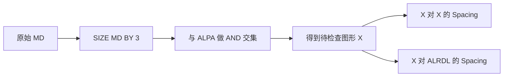
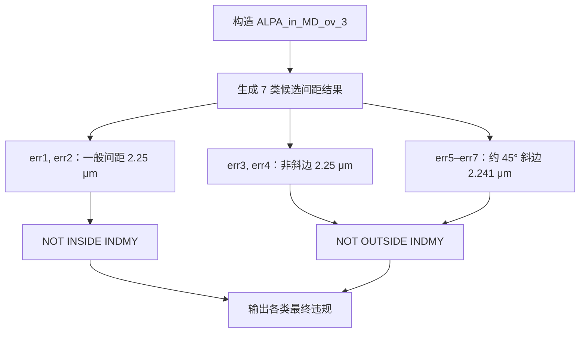

# 从 5 行到 14 行：28nm 与 14nm 的 ALPA 间距规则逐行讲解

**教学用技术讲义｜Calibre SVRF DRC 规则对比**  
**对比对象：** 28nm `ALPA_7` vs. 14nm `ALPA_S_2`  
**适用场景：** 给熟悉版图基础、正在学习 DRC Deck / 规则自动解析的同事讲解

> **先说结论：** 两条规则描述的核心任务几乎一样：检查 MD 外扩 3 μm 区域内的 ALPA 图形，与同类图形或 ALRDL 的平面最小间距。28nm 规则用 **5 条可执行语句**进行两类主检查；14nm 规则在规则块内使用 **14 条可执行语句**，分成 **7 类测量 + 7 类结果过滤**，专门处理 INDMY 区域及 45° 左右的斜边容差。
>
> **重要限定：** 这里对比的是版图中的**横向几何间距**，并非不同物理层之间的垂直层间距离。也不能仅由代码行数推出“14nm 的器件或 FinFET 必然造成了这些具体语句”。

---

## 01｜一张表先看懂差异

| 对比维度 | 28nm：`ALPA_7` | 14nm：`ALPA_S_2` |
|---|---|---|
| 自然语言核心要求 | ALPA 与 ALPA / ALRDL 的间距 | ALPA 与 ALPA / ALRDL 的间距 |
| 检查区域构造 | `ALPA AND (SIZE MD BY 3)` | 完全相同 |
| 标称最小间距 | **2.5 μm** | **2.25 μm** |
| 主体可执行语句 | **5 条**（2 次主间距检查） | **14 条**（7 次候选测量 + 7 次过滤） |
| 同多边形凹槽的处理 | 显式使用 `SPACE` / `NOTCH` | 注释要求豁免；对应实现需结合测量限定词解读 |
| 特殊区域 | `MARKS` | `INDMY` |
| 单独识别约 45° 斜边 | 未在此规则显式展开 | 使用 `ANGLE >44 <46` |
| 特定测量容差 | 未在该规则显式设定 | INDMY 相关的特定斜边检查减 **0.009 μm** |

**讲解要点：** 先强调两条规则的自然语言任务相近，再说明 14nm 的“十几行”实际上是在把不同几何情形拆开分别处理，而不是单纯反复执行同一个 `EXT`。

## 02｜这条规则到底检查什么？

### 2.1 图层和辅助对象

| 符号 | 在本对比中的作用 |
|---|---|
| `ALPA` | 被检查的版图图形所在图层；这里检查的是 ALPA 相关的平面间距。 |
| `MD` | 与 passivation-2 开口相关的图层；作为选取 ALPA 检查范围的依据。 |
| `ALRDL` | 由 ALPA 按线宽筛选出的**派生图层**，不是必须独立绘制的另一张掩模。 |
| `INDMY` | 特殊检查区域标记层；14nm 在该区域使用不同的测量筛选。 |
| `MARKS` | 28nm 规则最后排除的特殊标记区域。 |
| `X` / `ALPA_in_MD_ov_3` | 相同的辅助几何图形：ALPA 与扩展后的 MD 的交集。 |

在原文件中，ALRDL 的生成条件是：

```svrf
// 28nm 文件，第 9257 行
ALRDL = ALPA WITH WIDTH <= 35

// 14nm 文件，第 44043 行
ALRDL = ALPA WITH WIDTH < 35
```

两者都按 **35 μm 的宽度界限**筛选 ALPA，但对“恰好 35 μm”的边界值采用了不同的包含关系。这是实际代码差异之一，不宜在对比中忽略。

### 2.2 第一步：只选取 MD 附近的 ALPA

```svrf
X = ALPA AND (SIZE MD BY 3)                  // 28nm
ALPA_in_MD_ov_3 = ALPA AND (SIZE MD BY 3)    // 14nm
```

把它当作两个几何操作：先将 **MD 向外扩展 3 μm**，然后求它与 ALPA 的**交集**。因此不是检查所有 ALPA，而是检查 MD 扩展区域附近的那一部分。



**一个容易混淆的点：**`EXT A B` 在这里是二维版图中的外部距离检查，**不是**晶圆堆叠方向的“层间厚度”。

## 03｜28nm 原始规则与逐行解读

**来源文件：**`SmicDR1R_cal28_log_SION_sali_p1mtx_1051825_V1.10_1.drc`  
**原始行号：** 9316–9326。以下代码直接摘自上传文件。

```svrf
ALPA_7 {
@ Space between (ALPA AND (MD sizing up 3um)) and (ALPA AND (MD sizing up 3um)) or ALRDL.
@ ALRDL is defined as ALPA layer width equal or smaller than 35um.
@ This rule doesn’t check the space in the same polygon.	≥	2.5	um
  X = ALPA AND (SIZE MD BY 3)
  OUT1 = EXT X < 2.5 ABUT >0 < 90 SINGULAR REGION SPACE
  OUT1 NOT MARKS 

  OUT2 =  (EXT X ALRDL < 2.5 ABUT >0 < 90 SINGULAR REGION) NOT (EXT ALPA < 2.5 ABUT >0 < 90 SINGULAR REGION NOTCH)
  OUT2 NOT MARKS
}
```

### 3.1 五条语句逐行讲解

| 行号 | 原代码核心 | 具体含义 |
|---|---|---|
| **9320** | `X = ALPA AND (SIZE MD BY 3)` | **构造检查图形。** MD 扩展 3 μm，与 ALPA 取交集，得到 X。 |
| **9321** | `OUT1 = EXT X < 2.5 ... SPACE` | **第一类间距。** 检测 X 中不同多边形之间小于 2.5 μm 的外部间距；`SPACE` 对应不同多边形的空间间距情形。 |
| **9322** | `OUT1 NOT MARKS` | 将第一类检查结果中与 `MARKS` 重叠的部分排除，然后输出剩余违规。 |
| **9324** | `OUT2 = (EXT X ALRDL ...) NOT (EXT ALPA ... NOTCH)` | **第二类间距。** 先算 X 与 ALRDL 的近距离关系，再减去 ALPA 上的 `NOTCH` 类结果，以避免把本来同一多边形的窄凹槽当作目标外部间距。 |
| **9325** | `OUT2 NOT MARKS` | 对第二类检查结果过滤 `MARKS`，输出剩余违规。 |

### 3.2 最复杂的是 OUT2：拆成三段

```svrf
// A：X 与 ALRDL 的候选间距违规
EXT X ALRDL < 2.5 ABUT >0 < 90 SINGULAR REGION

// B：ALPA 同一多边形内部的窄凹槽候选
EXT ALPA < 2.5 ABUT >0 < 90 SINGULAR REGION NOTCH

// C：对 A 减去 B
OUT2 = (A) NOT (B)  // 这里的 A/B 是讲解用符号，并非源文件变量
```

- `EXT`：external spacing，即检查外部图形间的距离。
- `< 2.5`：只有测量值**严格小于** 2.5 μm 才满足这里的报错阈值。
- `ABUT >0 <90`：限定边缘邻接/测量的角度条件。
- `SINGULAR`：对测量结果施加特定的 singular 几何限定。
- `REGION`：以区域形式生成违规结果。
- `SPACE` 与 `NOTCH`：分别区分外部图形间距与同一多边形的内凹槽情形。
- `NOT`：对两个生成的几何结果做差集。

**28nm 流程小结：** 构造 X → 分别做 `X–X` 与 `X–ALRDL` 间距检查 → 对后者过滤内部凹槽 → 排除 MARKS → 输出违规。

## 04｜14nm 原始规则与逐行解读

**来源文件：**`1P8M_DV_3DM_Q1_3Q2_TMa_ALPA2.drc`  
**辅助图层定义行号：** 44189；**规则块行号：** 44191–44210。以下代码直接摘自上传文件。

```svrf
ALPA_in_MD_ov_3 = ALPA AND (SIZE MD BY 3)

ALPA_S_2 {
@ Space between (ALPA AND (MD sizing up 3um)) and (ALPA AND (MD sizing up 3um)) or ALRDL >= 2.25um
@ DRC waive space in same polygon
@ It allows 0.009um DRC checking tolerance in INDMY region
 err1 = EXT ALPA_in_MD_ov_3 < 2.25 ABUT<90 SINGULAR REGION SPACE
 err2 = EXT ALPA_in_MD_ov_3 ALRDL < 2.25 ABUT<90 SINGULAR REGION MEASURE ALL
 err3 = EXT ALPA_in_MD_ov_3 < 2.25 ABUT<90 SINGULAR REGION ANGLED==0 SPACE
 err4 = EXT ALPA_in_MD_ov_3 ALRDL < 2.25 ABUT<90 SINGULAR REGION MEASURE ALL ANGLED==0
 err5 = EXT ALPA_in_MD_ov_3 (ANGLE ALPA_in_MD_ov_3 > 44 < 46) < 2.25-0.009 ABUT<90 OPPOSITE2 REGION SPACE
 err6 = EXT ALPA_in_MD_ov_3 (ANGLE ALRDL > 44 < 46) < 2.25-0.009 ABUT<90 OPPOSITE2 REGION MEASURE ALL
 err7 = EXT (ANGLE ALPA_in_MD_ov_3 > 44 < 46) ALRDL < 2.25-0.009 ABUT<90 OPPOSITE1 REGION MEASURE ALL

 err1 NOT INSIDE INDMY
 err2 NOT INSIDE INDMY
 err3 NOT OUTSIDE INDMY
 err4 NOT OUTSIDE INDMY
 err5 NOT OUTSIDE INDMY
 err6 NOT OUTSIDE INDMY
 err7 NOT OUTSIDE INDMY
}
```

### 4.1 第 0 步：辅助图层

```svrf
ALPA_in_MD_ov_3 = ALPA AND (SIZE MD BY 3)
```

功能与 28nm 的 `X` **完全一样**。此行虽然紧挨规则块，但写在 `1P8M_DV_3DM_Q1_3Q2_TMa_ALPA2.drc` 的 `ALPA_S_2` 花括号外，**不计入规则块内的 14 条可执行语句**。

### 4.2 第 1 组：err1 和 err2——一般间距

```svrf
err1 = EXT ALPA_in_MD_ov_3 < 2.25 ABUT<90 SINGULAR REGION SPACE
err2 = EXT ALPA_in_MD_ov_3 ALRDL < 2.25 ABUT<90 SINGULAR REGION MEASURE ALL
```

- **err1**：`ALPA_in_MD_ov_3` 内不同多边形之间，查找小于 **2.25 μm** 的间距。可与 28nm 的 `OUT1` 对应。
- **err2**：检查目标 ALPA 与 `ALRDL` 之间小于 **2.25 μm** 的间距。可与 28nm 的 `OUT2` 的主要 `EXT` 测量对应。
- `MEASURE ALL` 是 Calibre 双层几何测量的限定选项，影响参与测量的候选几何关系；**不意味着无条件忽略所有其他限定词**。
- 注意 14nm 写的是 `ABUT<90`，28nm 写的是 `ABUT >0 <90`；二者并不是逐字相同的角度选择。

### 4.3 第 2 组：err3 和 err4——额外筛选不含斜边的间距

```svrf
err3 = EXT ALPA_in_MD_ov_3 < 2.25 ABUT<90 SINGULAR REGION ANGLED==0 SPACE
err4 = EXT ALPA_in_MD_ov_3 ALRDL < 2.25 ABUT<90 SINGULAR REGION MEASURE ALL ANGLED==0
```

- 两行的**对象**分别与 err1、err2 相对应。
- 新增 `ANGLED==0`，把测量限制在**没有斜向边缘参与**的边缘对（常见情形是水平/竖直边缘）。
- 最小间距仍为 **2.25 μm**，并没有因这个筛选而改变。
- 这两类结果后面使用 `NOT OUTSIDE INDMY`，与一般区域的 err1/err2 区别处理。

### 4.4 第 3 组：err5、err6、err7——约 45° 斜边和容差

```svrf
err5 = EXT ALPA_in_MD_ov_3 (ANGLE ALPA_in_MD_ov_3 > 44 < 46) < 2.25-0.009 ABUT<90 OPPOSITE2 REGION SPACE
err6 = EXT ALPA_in_MD_ov_3 (ANGLE ALRDL > 44 < 46) < 2.25-0.009 ABUT<90 OPPOSITE2 REGION MEASURE ALL
err7 = EXT (ANGLE ALPA_in_MD_ov_3 > 44 < 46) ALRDL < 2.25-0.009 ABUT<90 OPPOSITE1 REGION MEASURE ALL
```

这三行最能体现 14nm 的额外实现逻辑，关键有三点。

**① 对角度再细分。**`ANGLE ... > 44 < 46` 用来抽取与 X 轴形成 **44°–46°** 角度的边缘，即接近 **45°** 的斜边。

**② 在这些特定几何测量上引入容差。** 阈值在代码中写成：

**2.25 − 0.009 = 2.241 μm**

因此，落在这组**特定斜边测量条件**里的违规候选，要小于 **2.241 μm** 才会触发此项检测。它并不代表整个 ALPA 规则的间距都统一降低为 2.241 μm。

**③ 区分测量输入方向。**`OPPOSITE2` / `OPPOSITE1` 分别针对两层输入的不同边缘侧来限定 opposite 类型的测量关系。err6 将约 45° 的 ALRDL 边缘放在**第二输入**；err7 将约 45° 的目标 ALPA 边缘放在**第一输入**，因此使用不同的限定选项。

| 变量 | 被特别筛选的对象 | 小于多少时报候选违规 | 后续区域筛选 |
|---|---|---:|---|
| `err5` | `ALPA_in_MD_ov_3` 的约 45° 斜边，与同类对象测量 | 2.241 μm | INDMY 相关 |
| `err6` | `ALRDL` 的约 45° 斜边，与目标 ALPA 测量 | 2.241 μm | INDMY 相关 |
| `err7` | 目标 ALPA 的约 45° 斜边，与 `ALRDL` 测量 | 2.241 μm | INDMY 相关 |

### 4.5 第 4 组：7 行过滤语句——为什么还要写这么多？

```svrf
err1 NOT INSIDE INDMY
err2 NOT INSIDE INDMY
err3 NOT OUTSIDE INDMY
err4 NOT OUTSIDE INDMY
err5 NOT OUTSIDE INDMY
err6 NOT OUTSIDE INDMY
err7 NOT OUTSIDE INDMY
```

| 代码 | 作用 | 大致要保留的结果 |
|---|---|---|
| `err1 NOT INSIDE INDMY` | 剔除完全位于 INDMY 内部的 err1 结果 | 一般区域的 X–X 检查 |
| `err2 NOT INSIDE INDMY` | 剔除完全位于 INDMY 内部的 err2 结果 | 一般区域的 X–ALRDL 检查 |
| `err3 NOT OUTSIDE INDMY` | 剔除完全位于 INDMY 外部的 err3 结果 | INDMY 相关的正交边缘 X–X 检查 |
| `err4 NOT OUTSIDE INDMY` | 对 err4 做同类筛选 | INDMY 相关的正交边缘 X–ALRDL 检查 |
| `err5 NOT OUTSIDE INDMY` | 对 err5 做同类筛选 | INDMY 相关的 ALPA 约 45° 斜边检查 |
| `err6 NOT OUTSIDE INDMY` | 对 err6 做同类筛选 | INDMY 相关的 ALRDL 约 45° 斜边检查 |
| `err7 NOT OUTSIDE INDMY` | 对 err7 做同类筛选 | INDMY 相关的反向斜边检查 |

**重要的 SVRF 语义注意：**`NOT INSIDE` 和 `NOT OUTSIDE` 是**依据候选图形与 INDMY 的空间关系筛选几何结果**，不能不加区分地理解为布尔意义上的“只保留完全在区域外 / 完全在区域内”。跨越 INDMY 边界的图形应以 Calibre 实际判定为准。

### 4.6 14nm 的执行流程



## 05｜为什么 14nm 的规则长这么多？

**简明答案：它需要区分更多几何测量场景，而不仅仅是把间距数值改小。**

1. **检查区域被拆分。** 28nm 的这个规则主要有两类主检查，再统一排除 `MARKS`；14nm 分别处理一般区域与 INDMY 相关区域，产生了不同的结果过滤分支。
2. **边缘类型被拆分。** 14nm 显式区分未涉及斜边的测量 (`ANGLED==0`) 与约 45° 斜边 (`ANGLE >44 <46`)。
3. **斜边要进行容差判断。** 对特定 INDMY 相关的斜边测量采用 `2.25−0.009=2.241 μm`，并使用 `OPPOSITE1/2` 分别处理输入方向，故又增加了三组 `EXT`。

**可直接对同事讲的一句话：**

> 28nm 的这条规则主要是“测两个对象之间够不够远”；14nm 的对应规则除了测距离，还得先判断“在哪个区域、测的是哪种边缘、斜边是否适用容差、测量应从哪一侧进行”，所以同样一句间距描述就展开成了多条几何检查。

### 一个数字例子：体会“容差”到底改变了什么

假设某个测量值为 **2.245 μm**，并暂时只看这一条检查语句的数值阈值：

| 测量语句 | 判定表达式 | 2.245 μm 的比较结果 |
|---|---|---|
| 普通 `EXT < 2.25` | `2.245 < 2.25` | 成立：进入候选违规 |
| 特殊斜边 `EXT < 2.241` | `2.245 < 2.241` | 不成立：不触发该语句 |

这只是对**测量阈值**的教学示例。实际 DRC 结果仍取决于 `ANGLE`、`OPPOSITE`、`SPACE`、`INDMY` 等其余限定，以及 PDK 中其他可能适用的规则。

## 06｜SVRF 关键字速查表

| 关键字 | 在这两条规则里的用途 |
|---|---|
| `SIZE LAYER BY d` | 对图形做几何扩展（此处 `d=3 μm`）。 |
| `AND` | 求几何交集。 |
| `NOT` | 求几何差集，或在规则输出中排除指定区域。 |
| `WITH WIDTH` | 按多边形宽度条件筛选图形。 |
| `EXT` | 执行 external spacing（外部距离）几何检查。 |
| `ABUT` | 限定参与测量边缘的邻接角度。 |
| `SINGULAR` | 进一步限定该外部距离测量的几何情形。 |
| `REGION` | 将命中的检查关系表示为区域结果。 |
| `SPACE` | 关注不同多边形之间的间距情形。 |
| `NOTCH` | 关注同一多边形内的窄凹槽情形。 |
| `MEASURE ALL` | 调整双层间距检查中可参与的测量候选关系，需与其余限定共同理解。 |
| `ANGLED==0` | 筛选不含斜向边缘的测量边缘对。 |
| `ANGLE LAYER >44 <46` | 从图形中提取约 45° 的边缘。 |
| `OPPOSITE1 / OPPOSITE2` | 指定基于第一个 / 第二个输入边缘的 opposite 关系测量限定。 |
| `NOT INSIDE / NOT OUTSIDE` | 按结果图形与特殊区域的空间位置关系进行过滤。 |

## 07｜向别人讲解时，可以直接使用的 1 分钟讲解稿

“这两段 DRC 的自然语言要求几乎完全相同，都是检查 MD 扩展 3 微米附近的 ALPA 图形，与其他 ALPA 或 ALRDL 图形之间的间距。28nm 的实现比较集中：先构造待检查图形，然后分别测量 ALPA 与 ALPA、ALPA 与 ALRDL 的间距，再排除不需要报告的凹槽或标记区域，主体只有五条语句。

14nm 的规则在同一个基础检查对象上，把间距计算展开成七类：前两类做普通间距，另外两类处理不含斜边的测量，还有三类专门检查接近 45 度的斜边并引入 0.009 微米的检查容差。最后还要针对 INDMY 区域分别过滤。因此复杂的原因主要是‘区域、角度、容差、测量方向’这些附加条件，而不是规则名称或自然语言突然变了。要注意，这说明该条 14nm 规则的实现更细分，并不能仅凭这一例证明所有 14nm DRC 都比 28nm 复杂。”

## 08｜使用这组案例时的边界与出处

- **两个规则的核心检查对象一致**，描述相近，可以用来展示“相似文字背后，几何检查实现差异很大”。
- **两者并非所有条件完全一样**：阈值不同、`ABUT` 范围不同、`ALRDL` 在 35 μm 边界处的定义不同，区域豁免机制也不同。
- **“14nm 复杂”指这条规则的实现**，不代表同一工艺中每条 DRC 都更长；更不能只根据这些代码就断言是 FinFET 或某项具体制造设备造成的。
- 为保证可复核，原始代码保留了上传文件中的**规则名、注释、条件表达式与行号**。文中的教学示意、简化流程和解释不是 PDK 官方工艺原因说明；不替代 Calibre SVRF 手册与工艺设计规则手册。

**源文件索引**

- **28nm：**`SmicDR1R_cal28_log_SION_sali_p1mtx_1051825_V1.10_1.drc`，`ALRDL` 定义第 **9257** 行；`ALPA_7` 第 **9316–9326** 行。
- **14nm：**`1P8M_DV_3DM_Q1_3Q2_TMa_ALPA2.drc`，`ALRDL` 定义第 **44043** 行；辅助层第 **44189** 行；`ALPA_S_2` 第 **44191–44210** 行。

---

*讲解版 · 面向同事交流、规则分析与学习使用。*
